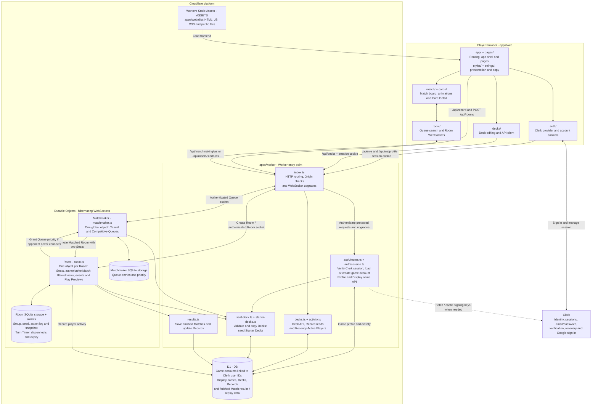

# cardduel

An online two-player card game played over rounds on a three-row battlefield.

## Source code map

This pnpm workspace has **two apps** and **three shared packages**. The web app renders the UI; the Cloudflare Worker serves it and handles API requests and authoritative Rooms. Both apps use the shared packages.

```text
├── apps/
│   ├── web/                     # React frontend
│   │   ├── src/
│   │   │   ├── main.tsx         # App entry point
│   │   │   ├── router.tsx       # Routes
│   │   │   ├── app/             # App shell
│   │   │   ├── auth/            # Sign-in and route protection
│   │   │   ├── pages/           # Home, account, Deck and Room pages
│   │   │   ├── match/           # Match board, choices, Play Preview, timer and animations
│   │   │   ├── cards/           # Card rendering, artwork, icons and Card Detail
│   │   │   ├── decks/           # Deck editing helpers and API client
│   │   │   ├── room/            # WebSockets, Queue search and in-browser Local Room
│   │   │   ├── dev/             # Development-only Local Room and card gallery pages
│   │   │   ├── styles/          # Design tokens and shared styles
│   │   │   └── strings/         # English UI copy; features also have local strings/
│   │   └── e2e/                # Playwright accessibility and browser flow tests
│   └── worker/                 # Cloudflare backend
│       ├── src/
│       │   ├── index.ts        # API routing and static asset serving
│       │   ├── room.ts         # Authoritative Room Durable Object
│       │   ├── matchmaker.ts   # Matchmaking Durable Object
│       │   ├── auth/           # Authentication and account routes
│       │   ├── decks.ts        # Deck storage and API
│       │   └── results.ts      # Match results and Records
│       ├── migrations/         # D1 database schema migrations
│       ├── test/               # Worker integration tests
│       └── scripts/            # Preview database tooling
├── packages/
│   ├── engine/src/             # Deterministic Match rules, player views, Play Preview
│   │                           # and shared Room protocol
│   ├── catalog/
│   │   ├── data/               # Versioned cards, names, ability text, Deck limits
│   │   │                       # and Starter Decks
│   │   └── src/                # Card Catalog loading and Deck validation
│   └── strings/src/            # Shared formatCopy helper for named replacements
├── docs/
│   ├── adr/                    # Architecture decisions
│   ├── accessibility/          # Accessibility requirements
│   ├── agents/                 # Contributor guidance
│   └── authentication.md       # Authentication setup and behavior
├── tools/                      # Cleanup script, Biome rules and auth test helpers
└── GLOSSARY.md                 # Domain terminology
```

Unit tests generally sit beside the source they cover as `*.test.ts` or `*.test.tsx`.

## Architecture

Production runs on one Cloudflare Worker deployment with Workers Static Assets, Room and Matchmaker Durable Objects, and a D1 database. Each player runs the React app in their browser. Solid arrows below show runtime calls or data flow; the dashed arrow shows signing-key retrieval when a Clerk public key is not configured locally.



The Worker authenticates the HTTP request or WebSocket upgrade before forwarding a trusted account ID to a Durable Object. Clerk owns credentials and sessions; D1 owns game data. The Room applies actions through the engine and sends each Seat only its filtered view, events and server-computed Play Previews. Its seed and action log can rebuild the cached Match snapshot; completed results and Records are written to D1.

## Development

`pnpm dev` runs the web app (Vite, http://localhost:5173) and the Worker together. `pnpm check` runs what CI runs: typecheck, lint, unit tests and end-to-end tests.

Development-only pages run the engine in the browser without Clerk or the Worker. For normal local development, Vite serves the frontend and proxies `/api` HTTP and WebSocket requests to Wrangler. GitHub Actions builds the frontend, applies D1 migrations and deploys the Worker with its static assets; PR Previews use a shared preview D1 database and the development Clerk instance. See [authentication setup](docs/authentication.md) and the [architecture decisions](docs/adr/) for details.

### Dev-only routes

These pages exist only in the Vite dev server (`import.meta.env.DEV`); production builds leave them out. They need no sign-in and no Worker: the Match engine runs in the browser.

| Route | What it shows |
|---|---|
| `/dev/local` | A **Local Room**: one browser plays both Seats of a Match. The **Local Room · looking at** box (top right) switches between Seat 1 and Seat 2. |
| `/dev/cards` | The **card gallery**: every card of the current Card Catalog at every size, with raised and lowered Strength. |

`/dev/local` takes these query parameters:

| Parameter | Values | Default |
|---|---|---|
| `seed` | Any number. The same seed and the same actions give the same Match. | `1` |
| `deck` | `plain`: plain Units only. `starter`: the v1 Starter Decks, Swarm against Court. `v2`: the v2 Starter Decks, Kingdom against Vikings. `elves`: the v2 Starter Decks, Elves against Vikings. | `plain` |
| `scenario` | A fixed board for working on one part of the Match UI; when set, `seed` and `deck` are ignored. `scorch`, `horn` and `medic`, or `leader-<kind>` for a Leader ability: `playWeatherFromDeck`, `clearWeather`, `hornRow`, `scorchRow`, `returnFromDiscard`, `drawChosenFromDeck`, `lookAtOpponentHand`. | none |

Examples: `/dev/local?seed=7&deck=starter`, `/dev/local?deck=elves`, `/dev/local?scenario=leader-hornRow`.
